<h1 align="center">Reccut</h1>

<p align="center">
  Record your screen and camera, then edit the recording.<br>
  Free and open source, for Mac and Windows.
</p>

<p align="center">
  <a href="https://github.com/sirbull/reccut/releases/latest"><b>Download</b></a>
  &nbsp;·&nbsp;
  <a href="#install">Install</a>
  &nbsp;·&nbsp;
  <a href="#build-from-source">Build from source</a>
  &nbsp;·&nbsp;
  <a href="docs/FUNKSJONER.md">Full feature list (Norwegian)</a>
</p>

<p align="center">
  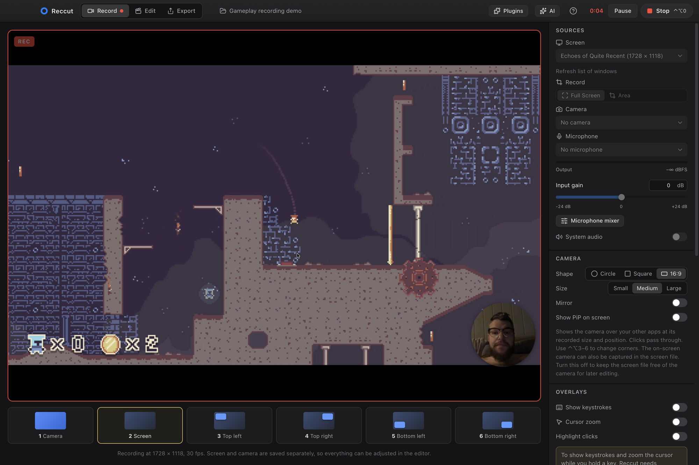
</p>

Reccut is a free, open-source screen recorder and video editor for Mac and Windows. Record your screen with your camera and microphone, then cut out mistakes, add titles or subtitles and export the finished video in the same app.

You can also edit footage from other cameras, or use **Export** to convert files. Recording and editing run on your own machine and work offline. Optional **AI agents** can do the editing for you using a model you choose from a cloud provider or a local model server.

## Screen and camera recording

The demo above shows me playing my own game, Echoes of Quite Recent, with my camera in the corner.

Record the whole screen, a single window or a selected area, with your webcam and microphone. You can also record the camera on its own. Use it for a tutorial, a presentation, gameplay or a piece to camera.

When you stop, click **Edit** to open the recording on the timeline. Trim the start and end, cut out a mistake, add subtitles or music, and export. Screen and camera are stored separately, along with the layout, cursor movements and keystrokes, so you can change the camera position or hide overlays after recording.

<p align="center">
  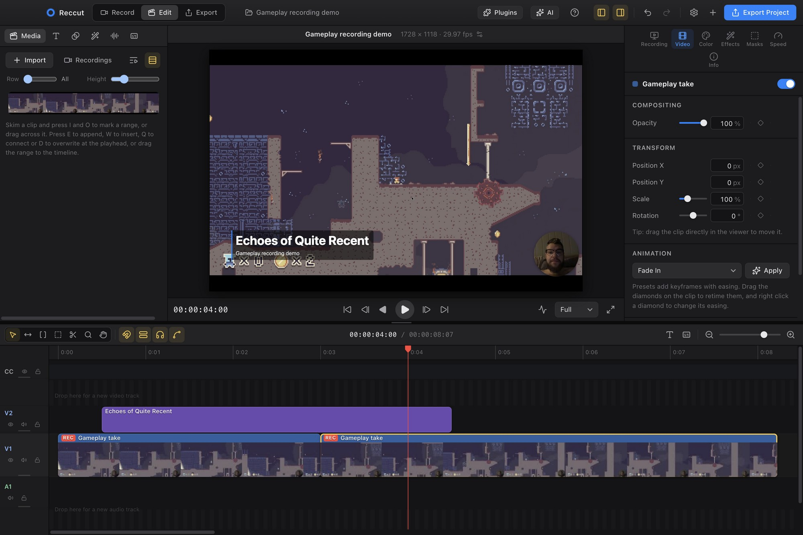
</p>

A global shortcut starts and stops recording from any app. Pause and resume without leaving gaps in the video. A floating control bar shows the recording time and controls without appearing in the recording. Recordings are saved as you go, with recovery after a crash.

## Titles and lower thirds

<p align="center">
  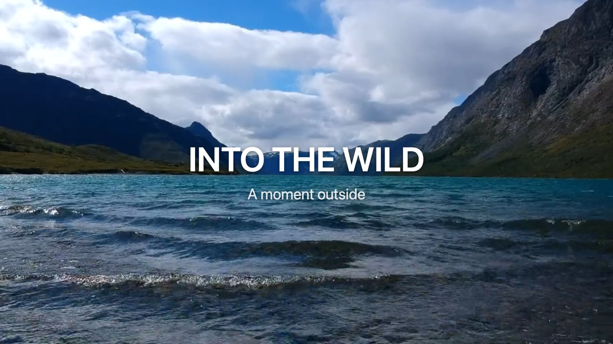
  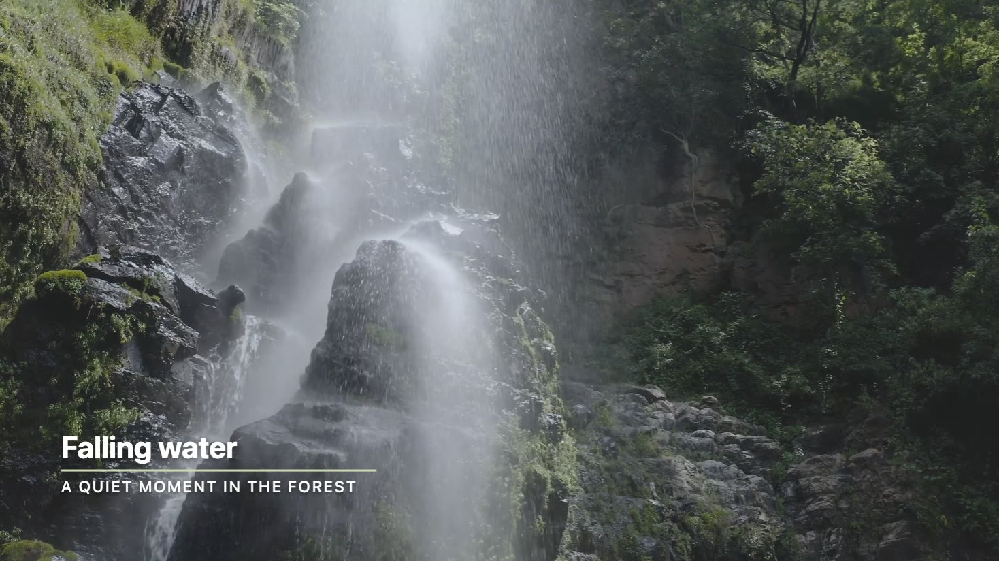
</p>

Drop a title on the timeline, type in the inspector and drag it into place in the viewer. The animation in and out follows the length of the clip. There are templates for headlines, title cards, typewriter text, end cards and a range of lower thirds, and you can design your own in After Effects with the included template kit. Photoshop and Illustrator files come in with their layers intact.

## Colour and film looks

<p align="center">
  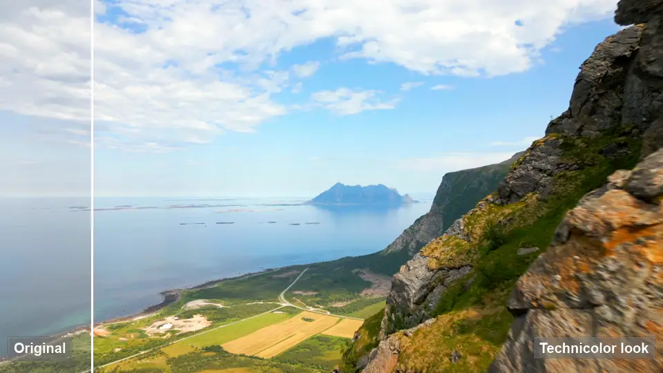
</p>

Exposure, contrast, temperature, tint and three-way colour wheels, calculated on the GPU in 16-bit float, so 10-bit footage keeps its smooth gradients. On top of that sit more than 40 film looks, from colour stocks like Portra and Velvia to cinema film, black and white, and toned prints.

<p align="center">
  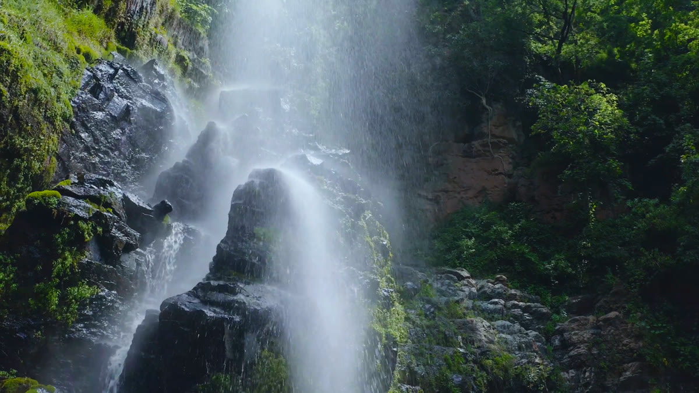
  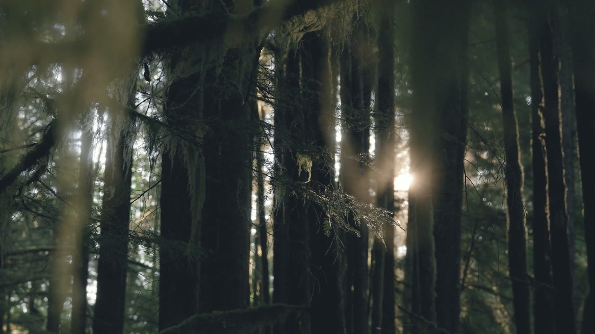
  
  <br>
  
  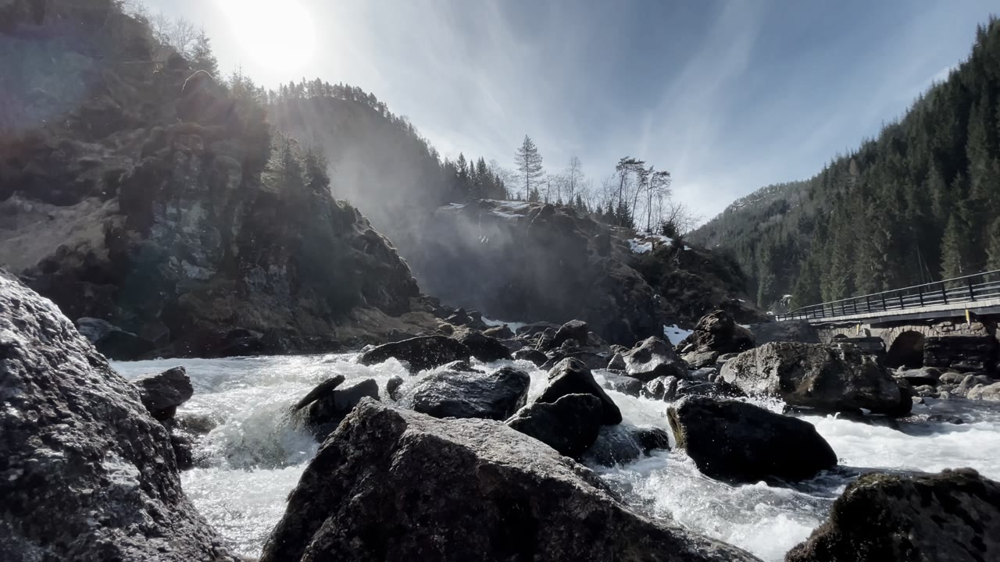
  
  <br>
  <sub>Velvia 50 · Vision3 500T · Golden hour · Portra 400 · Bleach bypass · Tri-X 400</sub>
</p>

LOG footage from Apple, Sony, Panasonic, Fujifilm and ARRI is converted with one click, or you can load your own `.cube` LUT. HDR clips are recognised and tone-mapped.

## Editing

<p align="center">
  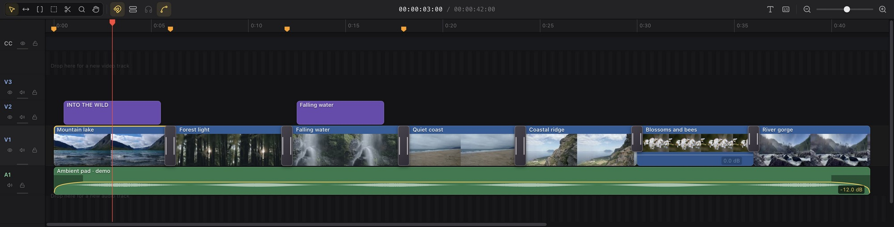
</p>

If you have used Final Cut Pro, the timeline will feel familiar: a magnetic main storyline with connected clips above and audio below, and the same tools and shortcuts (select, trim, position, range, blade). Skim over clips to see and hear them, mark a range in the browser and drop it in.

- Roll, slip and slide, J- and L-cuts, unlimited video and audio tracks
- Speed changes and speed ramps, reverse, freeze frames
- Keyframes with easing on almost everything
- Stabilization, masks drawn with a pen tool, chroma and luma keying
- Pixelate or blur faces and passwords, and follow them with keyframes
- Audio repair (noise reduction, hum removal, de-esser), EQ, compressor and 30+ presets
- Automatic audio sync with an external recorder
- Subtitles with automatic transcription by Whisper, plus SRT and WebVTT import and export

## Export

<p align="center">
  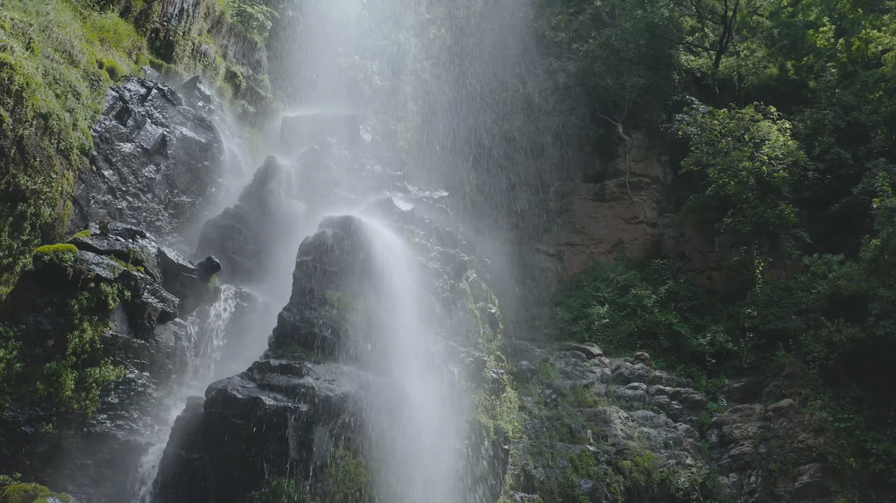
  &nbsp;
  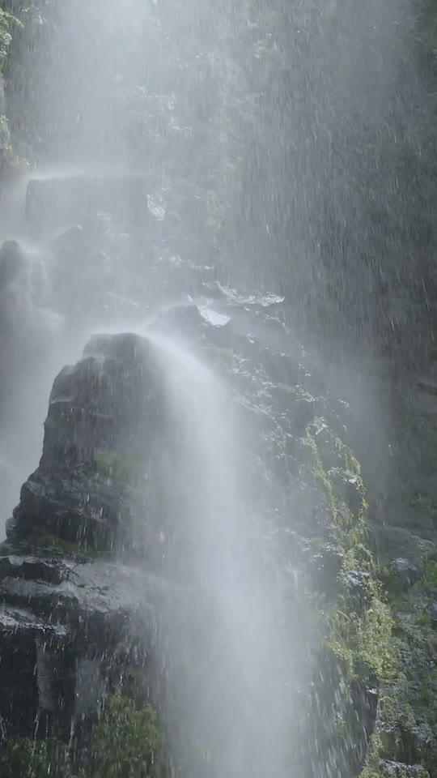
  &nbsp;
  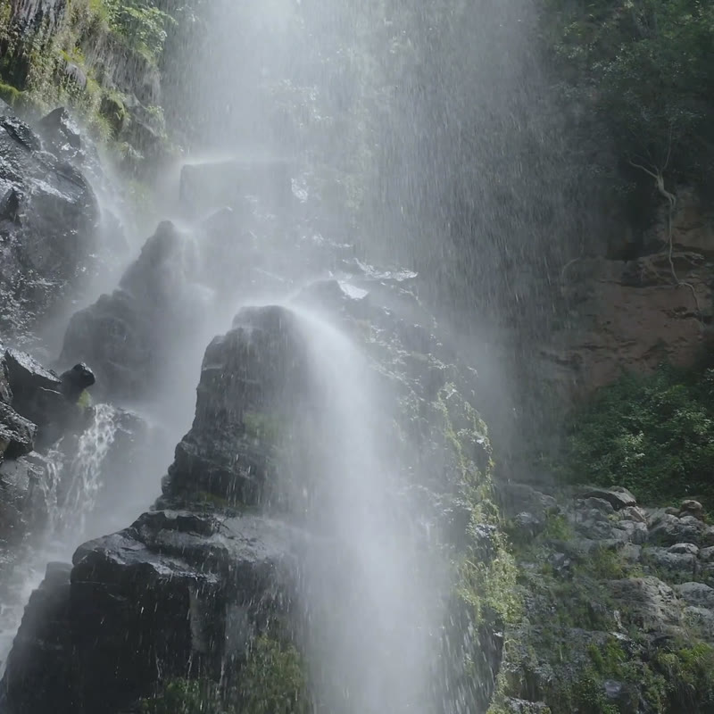
  <br>
  <sub>The same shot in landscape, portrait and square formats</sub>
</p>

Choose a preset (YouTube, Apple devices, smallest file, master, GIF, audio only) or set everything yourself: size, crop, frame rate, quality and range. Subtitles can be burned in, added as a track, or saved as separate files. Exports run in a queue in the background, and existing files are never overwritten.

| Video | Audio |
| --- | --- |
| MP4 (H.264, HEVC, AV1), WebM (VP9, AV1), MOV (H.264, ProRes 422), MKV, GIF | MP3, AAC, WAV, FLAC, Opus |

Reccut opens almost anything: ProRes, DNxHR, 10-bit HEVC, AVCHD, MXF, image sequences, camera RAW stills and RAW video through the manufacturers' own tools. What can't be played directly is converted in the background.

## AI agents and model choice

Connect a model in **Settings → AI & Plugins**, then ask the AI agent to edit your recording or other footage. For example: *"cut this recording down to a minute and add English subtitles"*. The agent can inspect the project and use Reccut's tools to cut clips, adjust colour and add titles. Review the edits on the timeline; its changes can be undone.

Choose a provider and model, and add your own API key. Reccut supports OpenAI, Anthropic (Claude), Google (Gemini), Mistral, OpenRouter and other providers. You can also connect a local model through Ollama, LM Studio or llama.cpp. Choose a model with **tool calling** so the agent can use the editing tools. Cloud models use your provider account; local models run through the server you configure.

AI is optional. Recording, manual editing and export work without it. The agent can also write plugins for you to review and approve. See [model setup](docs/AI-MODELS.md) and [AI, keying and plugins](docs/KEYING-AND-AI.md).

## Open source

Reccut's source code is available under the **MIT licence**. You can build it yourself, change it and contribute improvements. There is no subscription, account requirement or watermark for recording and editing. Bug reports, fixes and documentation contributions are welcome on [GitHub](https://github.com/sirbull/reccut).

## Install

Download the latest version from [Releases](https://github.com/sirbull/reccut/releases/latest): `.dmg` for Mac (Apple Silicon and Intel) and `.exe` for Windows.

The app is not code-signed yet:

- **Mac:** if macOS says the app is damaged, run `xattr -cr /Applications/Reccut.app` in Terminal. Allow access to camera, microphone and screen recording. Keystrokes and cursor zoom also need access under Privacy & Security → Accessibility. Restart the app after granting access.
- **Windows:** if SmartScreen warns you, choose **More info** and **Run anyway**.

Reccut checks GitHub for new versions once a day and can download the installer for you. Nothing is installed until you open it yourself, and the check can be turned off in Settings.

## Build from source

Requires Node.js 20 or newer.

```bash
git clone https://github.com/sirbull/reccut.git
cd reccut
npm install      # also downloads FFmpeg
npm start        # builds the interface and starts the app
npm test         # tests the editing logic
npm run dist:mac # or dist:win, builds an installer
```

`npm start` runs with its own profile (**Reccut Development**), so it doesn't share settings with an installed copy.

To publish a new version, bump the version in `package.json`, tag it (for example `v0.3.0`) and push the tag. The workflow in `.github/workflows/build.yml` builds for Mac and Windows and attaches the files to a release.

| Folder | Contents |
| --- | --- |
| `src/main` | Electron main process: windows, recording to disk, keyboard hooks, FFmpeg, background jobs, projects |
| `src/shared` | Project model, editing operations and the render engine, shared by preview and export |
| `src/renderer` | The interface in Preact: record, edit, export, the command registry and the help |
| `src/worker` | Hidden windows for export and transcription |
| `assets/template-kit` | After Effects template kit and the `.reccut-title` format |

## Documentation

- **In the app:** Help → Reccut Help (F1) opens the handbook, with search and pictures. It works offline.
- [Full feature list, shortcuts and settings](docs/FUNKSJONER.md) (Norwegian)
- [AI, keying and plugins](docs/KEYING-AND-AI.md)

## Licence

Reccut is released under the MIT licence.

It is built on Electron, Preact, Mediabunny, FFmpeg, uiohook-napi, Lucide and Transformers.js (Whisper). The bundled FFmpeg binaries are GPL-licensed, built without `--enable-nonfree`, and ship with the app together with `LICENSE-FFmpeg.txt`.
