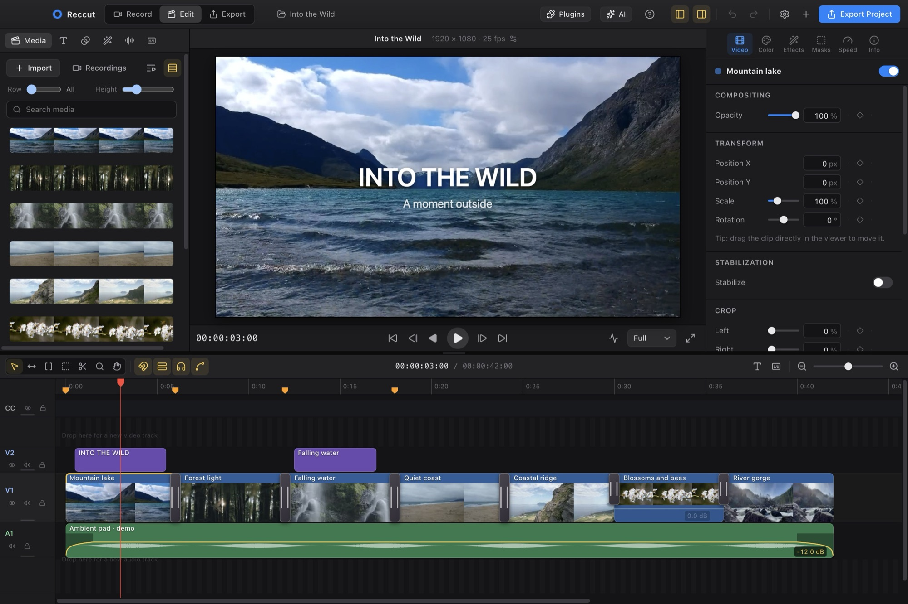
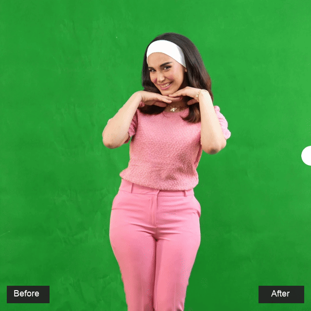
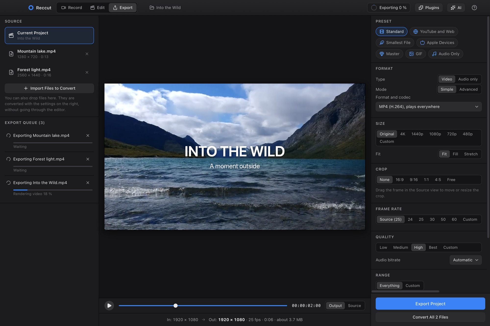

<h1 align="center">Reccut</h1>

<p align="center">
  Video editing and screen recording in one app.<br>
  Free and open source, for Mac, Windows and Linux.
</p>

<p align="center">
  <a href="https://github.com/sirbull/reccut/releases/latest"><b>Download</b></a>
  &nbsp;·&nbsp;
  <a href="#install">Install</a>
  &nbsp;·&nbsp;
  <a href="#build-from-source">Build from source</a>
  &nbsp;·&nbsp;
  <a href="docs/FUNKSJONER.md">Full feature list (Norwegian)</a>
</p>

<p align="center">
  
</p>

Reccut is a free, open-source video editor and screen recorder for Mac, Windows and Linux. Import video from your camera or phone, arrange clips on a magnetic timeline, mix sound, correct colour and add titles or subtitles. Use it for a short film, an interview, a travel video or a YouTube project.

The built-in screen recorder captures your screen, camera and microphone straight into a project. You can also use **Export** to convert files. Recording and editing run on your own machine and work offline. Optional **AI agents** can edit for you using a model you choose from a cloud provider or a local model server.

## Video editing

<p align="center">
  
</p>

Import video, audio and images into a project and build your edit from there. Skim through clips in the media browser, mark the parts you want and add them to the timeline. Video, titles and graphics can sit above the main track, with dialogue, music and sound effects below.

If you use Final Cut Pro, the magnetic main storyline and editing shortcuts will feel familiar. The main track closes gaps as you work, while connected clips stay with the shots they belong to. Use select, trim, position, range and blade tools to make the edit.

- Roll, slip and slide, J- and L-cuts, unlimited video and audio tracks
- Speed changes and speed ramps, reverse, freeze frames
- Keyframes with easing on almost everything
- Stabilization, masks drawn with a pen tool, chroma and luma keying
- Pixelate or blur faces and passwords, and follow them with keyframes
- Audio repair (noise reduction, hum removal, de-esser), EQ, compressor and 30+ presets
- Automatic audio sync with an external recorder
- Subtitles with automatic transcription by Whisper, plus SRT and WebVTT import and export

## Screen and camera recording

<p align="center">
  
  <br>
  <sub>Playing my own game, Echoes of Quite Recent, with my camera in the corner.</sub>
</p>

Record the whole screen, a single window or a selected area, with your webcam and microphone. You can also record the camera on its own. Use it for a tutorial, a presentation, gameplay or a piece to camera.

When you stop, click **Edit** to open the recording on the timeline. Trim the start and end, cut out a mistake, add subtitles or music, and export. Screen and camera are stored separately, along with the layout, cursor movements and keystrokes, so you can change the camera position or hide overlays after recording.

The camera appears as a separate **PiP** clip on V2, linked to the screen clip on V1. Click PiP and open **Color → Camera Color** to adjust exposure, contrast, saturation and temperature for the camera alone. Linked clips stay in sync when moved, trimmed or cut. Choose **Detach PiP** to edit its timing independently, and reconnect it in **Recording → PiP Connection**. Older combined clips can use **Show PiP on Separate Track**. Adjustments are saved with the project and included in exports.

<p align="center">
  
</p>

A global shortcut starts and stops recording from any app. Pause and resume without leaving gaps in the video. A floating control bar shows the recording time and controls without appearing in the recording. Recordings are saved as you go, with recovery after a crash.

## One-click background removal and advanced keying

<p align="center">
  
  <br>
  <sub>Green screen before and after chroma key. <a href="https://sirbull.github.io/reccut/#keying">Try the interactive slider on the website.</a></sub>
</p>

Click **Remove solid background** to remove a green or blue screen with one click. Reccut samples the background colour from the source frame and applies chroma key automatically. Place the keyed clip over another video or image.

For more demanding shots, adjust **Tolerance** and **Softness**, then open **Advanced** for fine-detail recovery, source-shadow preservation, edge-colour recovery and spill removal. You can also adjust matte black, white and gamma, shrink or expand edges, add feathering and inspect the matte. Start with the automatic result and refine it as needed.

The camera recording is a separate **PiP** clip in Edit. Select it and open **Effects → Keying & effect stack** to remove its background without changing the screen recording. You can also use a mask to keep only the part of the camera image you want. For a static background without a green screen, use **Remove static background** with a fixed camera and steady lighting, or capture a clean background reference.

Draw masks with the pen tool and animate their position or shape with keyframes. Stabilization smooths shaky footage, and effects can be combined with colour correction, titles and speed ramps. Keying and masks are applied in the editor and used in both the preview and export. See [keying and background removal](docs/KEYING-AND-AI.md) for the controls and requirements.

## Titles and lower thirds

<p align="center">
  
  
</p>

Drop a title on the timeline, type in the inspector and drag it into place in the viewer. The animation in and out follows the length of the clip. There are templates for headlines, title cards, typewriter text, end cards and a range of lower thirds, and you can design your own in After Effects with the included template kit. Photoshop and Illustrator files come in with their layers intact.

## Colour and film looks

<p align="center">
  
</p>

Exposure, contrast, temperature, tint and three-way colour wheels, calculated on the GPU in 16-bit float, so 10-bit footage keeps its smooth gradients. On top of that sit more than 40 film looks, from colour stocks like Portra and Velvia to cinema film, black and white, and toned prints.

<p align="center">
  
  
  
  <br>
  
  
  
  <br>
  <sub>Velvia 50 · Vision3 500T · Golden hour · Portra 400 · Bleach bypass · Tri-X 400</sub>
</p>

LOG footage from Apple, Sony, Panasonic, Fujifilm and ARRI is converted with one click, or you can load your own `.cube` LUT. HDR clips are recognised and tone-mapped.

## Import formats

These are some of the formats and codecs Reccut can import. Many more are read through FFmpeg. Files that need conversion are prepared in the background for editing.

| | Video | Audio |
| --- | --- | --- |
| **Codecs** | H.264 / AVC, H.265 / HEVC (including 10-bit), AV1, VP8, VP9, ProRes, DNxHD / DNxHR, MPEG-2, MPEG-4, MJPEG, DV, WMV, VC-1 | MP3, AAC, ALAC (Apple Lossless), PCM, FLAC, Vorbis, Opus, WMA, AC-3, E-AC-3, DTS, AMR, APE (Monkey’s Audio), WavPack |
| **File formats and containers** | MP4, MOV / QuickTime, M4V, MKV, WebM, AVI, MXF, MPEG / MPG, TS, MTS / M2TS (AVCHD), VOB, 3GP, OGV | MP3, WAV, M4A / M4B, AAC, FLAC, AIFF / AIF, Ogg / OGA, Opus, WebM audio, WMA, CAF, MKA, AC3 / EAC3, DTS, AMR, APE, WV, AU, W64, RF64 |

You can also import numbered image sequences, camera RAW stills and LOG footage. HDR (PQ and HLG) is tone-mapped to SDR for editing and export. RAW video such as BRAW, R3D, N-RAW, ARRIRAW and ProRes RAW requires the appropriate external decoder; availability depends on the format and platform.

## Export and batch conversion

Export is also a video and audio converter. Drop in files, make smaller copies, change formats or extract audio, without adding anything to an editing timeline. It is included in Reccut, free and open source.

<p align="center">
  
  <br>
  <sub>A project export and two file conversions in the same queue.</sub>
</p>

- **Export a project:** click the blue **Export Project** button in the editor (or Cmd/Ctrl+E). The current project opens in Export with MP4/H.264, high quality, and the sequence’s size and frame rate. Review or change the settings, then click **Export Project** in the Export tab to start the job.
- **Convert files:** import or drop video and audio files into Export. Choose settings and convert one file, or use **Convert All** to queue the imported files.
- **Make another version:** change the codec, size, crop, frame rate or quality for a smaller file, a different aspect ratio or an editing master.
- **Background queue:** follow progress, cancel jobs and open finished files while continuing to edit. Existing output files are not overwritten.

<p align="center">
  
  &nbsp;
  
  &nbsp;
  
  <br>
  <sub>The same shot in landscape, portrait and square formats</sub>
</p>

Choose a preset (YouTube, Apple devices, smallest file, master, GIF, audio only) or set everything yourself: size, crop, frame rate, quality and range. Subtitles can be burned in, added as a track, or saved as separate files. Exports run in a queue in the background, and existing files are never overwritten.

| Video | Audio |
| --- | --- |
| MP4 (H.264, H.265/HEVC, AV1), WebM (VP9, AV1), MOV (H.264, ProRes 422), MKV, GIF | MP3, AAC, WAV, FLAC, Opus |

## AI agents and model choice

Connect a model in **Settings → AI & Plugins**, import your clips and ask the AI agent to edit them. You can attach a script in the AI chat:

> “Read the script I’ve attached and make a first cut from my camera takes and screen recordings. Use the best takes and show the screen when I explain each step.”

The agent can read the script, transcribe the takes and build a sequence with camera footage, screen recordings, titles and subtitles. Review and adjust the first cut on the timeline; its changes can be undone. The result depends on the model and the material you give it.

Choose a provider and model, and add your own API key. Reccut supports OpenAI, Anthropic (Claude), Google (Gemini), Mistral, OpenRouter and other providers. You can also connect a local model through Ollama, LM Studio or llama.cpp. Choose a model with **tool calling** so the agent can use the editing tools. Cloud models use your provider account; local models run through the server you configure.

AI is optional. Recording, manual editing and export work without it. The agent can also write plugins for you to review and approve. See [model setup](docs/AI-MODELS.md) and [AI, keying and plugins](docs/KEYING-AND-AI.md).

## Open source

Reccut's source code is available under the **MIT licence**. You can build it yourself, change it and contribute improvements. There is no subscription, account requirement or watermark for recording and editing. Bug reports, fixes and documentation contributions are welcome on [GitHub](https://github.com/sirbull/reccut).

## Install

Download the latest version from [Releases](https://github.com/sirbull/reccut/releases/latest): `.dmg` for Mac (Apple Silicon and Intel), `.exe` for Windows and `.AppImage` for Linux (x64).

The app is not code-signed yet:

- **Mac:** if macOS says the app is damaged, run `xattr -cr /Applications/Reccut.app` in Terminal. Allow access to camera, microphone and screen recording. Keystrokes and cursor zoom also need access under Privacy & Security → Accessibility. Restart the app after granting access.
- **Windows:** if SmartScreen warns you, choose **More info** and **Run anyway**.
- **Linux:** run `chmod +x Reccut-*.AppImage` and start the file. Ubuntu 22.04 and newer need `sudo apt install libfuse2`. If it closes right away with a sandbox error (Ubuntu 24.04), start it with `--no-sandbox`. Keystrokes and cursor zoom need an X11 session. System audio is not recorded on Linux, and HEVC clips are converted before playback.

Reccut checks GitHub for new versions once a day and can download the installer for you. Nothing is installed until you open it yourself, and the check can be turned off in Settings.

## Build from source

Requires Node.js 20 or newer.

```bash
git clone https://github.com/sirbull/reccut.git
cd reccut
npm install      # also downloads FFmpeg
npm start        # builds the interface and starts the app
npm test         # tests the editing logic
npm run dist:mac # or dist:win / dist:linux, builds an installer
```

`npm start` runs with its own profile (**Reccut Development**), so it doesn't share settings with an installed copy.

To publish a new version, bump the version in `package.json`, tag it (for example `v0.3.0`) and push the tag. The workflow in `.github/workflows/build.yml` builds for Mac, Windows and Linux and attaches the files to a release.

| Folder | Contents |
| --- | --- |
| `src/main` | Electron main process: windows, recording to disk, keyboard hooks, FFmpeg, background jobs, projects |
| `src/shared` | Project model, editing operations and the render engine, shared by preview and export |
| `src/renderer` | The interface in Preact: record, edit, export, the command registry and the help |
| `src/worker` | Hidden windows for export and transcription |
| `assets/template-kit` | After Effects template kit and the `.reccut-title` format |

## Documentation

- **In the app:** Help → Reccut Help (F1) opens the handbook, with search and pictures. It works offline.
- [Full feature list, shortcuts and settings](docs/FUNKSJONER.md) (Norwegian)
- [AI, keying and plugins](docs/KEYING-AND-AI.md)

## Licence

Reccut is released under the MIT licence.

It is built on Electron, Preact, Mediabunny, FFmpeg, uiohook-napi, Lucide and Transformers.js (Whisper). The bundled FFmpeg binaries are GPL-licensed, built without `--enable-nonfree`, and ship with the app together with `LICENSE-FFmpeg.txt`.
