# Multicam Clips

Create and synchronize camera angles, choose the program live or one section at a time, adjust sound, recover drafts and continue editing on the timeline.

<!-- Generated from src/renderer/help/articles.js with node scripts/document-multicam.mjs. -->

## Contents

- [Quick start](#quick-start)
- [Make a multicam clip](#make-a-multicam-clip)
- [The multicam window](#the-multicam-window)
- [Synchronize the cameras](#synchronize-the-cameras)
- [Switch cameras](#switch-cameras)
- [The multicam timeline](#the-multicam-timeline)
- [Sound](#sound)
- [Add it to the timeline](#add-it-to-the-timeline)
- [Change it later](#change-it-later)
- [Save and recover an unfinished edit](#save-and-recover-an-unfinished-edit)
- [Keyboard reference](#keyboard-reference)
- [Troubleshooting](#troubleshooting)
- [Tips](#tips)

A multicam clip holds the clips from several cameras that recorded the same thing at the same time, for example an interview filmed from the front and from the side. Reccut lines them up by their sound. You watch all the cameras at once and press a number to choose which one is shown. Reccut cuts the clips for you, so only one camera shows at a time, and the sound comes from the best microphone the whole way.

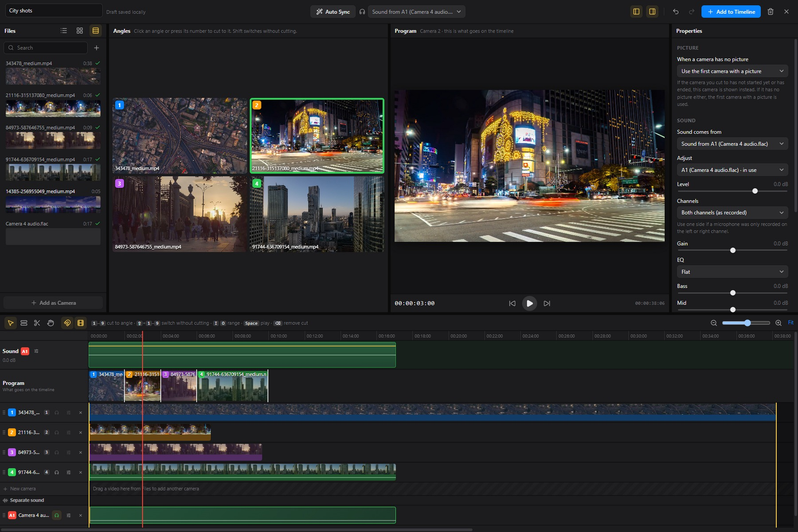

## Quick start

1. Import the video from each camera into the project. Add a separate audio recording too, if you have one.
2. Select the files in the media browser and choose **File › New Multicam Clip…**. Give the clip a name at the top left.
3. If the files recorded the same event with shared sound, press **Auto Sync**. Check the result and line up any remaining files by hand.
4. Put the playhead where the edit should start and choose a camera in **Angles**, or press its number. Program begins at that position.
5. Press **Space** and use **1–9** to switch cameras as you watch. Press Space again when you reach the end you want.
6. Choose the sound source and make any level adjustments. Review the Program track, then press **Add to Timeline** at the top right.

The city footage in these pictures demonstrates camera choices and the editing controls. These are different city shots rather than cameras recording one event, and their audio tracks contain silence. The separate audio example is extracted from camera 4. Use recordings with shared, audible sound when following the audio synchronization steps with your own footage.

## Make a multicam clip

There are two ways to start:

- **From clips on the timeline.** Put the clips from each camera on top of each other, select them and right click one of them. Choose **Create Multicam Clip…**. Their positions are kept. Program starts empty so you can choose the cameras yourself.
- **From files.** Choose File › **New Multicam Clip…**, or right click an empty part of the timeline. Files you selected in the browser are added straight away. You add more in the window.

Starting from timeline clips keeps the originals in place while the multicam window is open. **Add to Timeline** replaces those selected clips when you apply the result.

Angles accept video files and separate audio files. Still images and Reccut screen-and-camera recordings cannot be used as angles. An already-added file has a check mark in Files. Use **Ctrl click** on Windows or **Cmd click** on Mac to select several files, and **Shift click** to select a range, then use **Add Files**. Double clicking adds one file immediately.

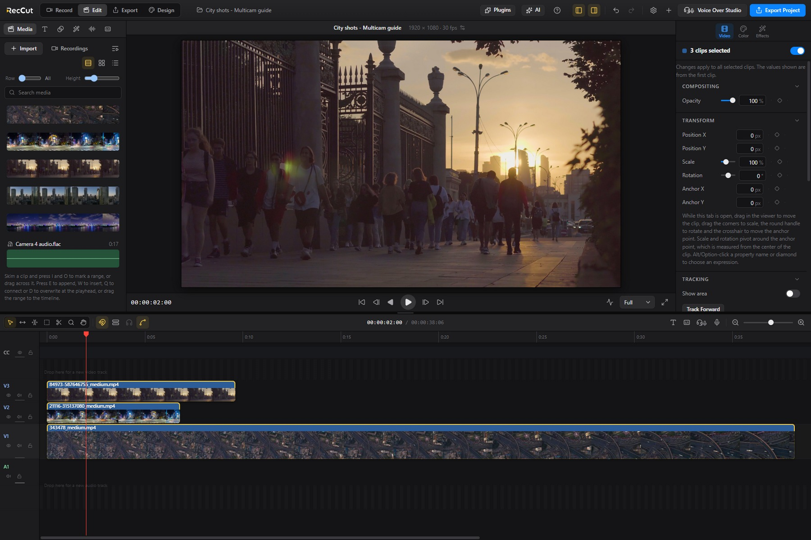

## The multicam window

The window has five parts:

1. **Files** on the left. All video and audio in the project. Double click a file, or drag it to Angles or the timeline, to add it. Switch between list, icon and filmstrip view at the top. The + button imports new files into the project.
2. **Angles**. All cameras at once, in small views numbered **1, 2, 3** in the order they were added. The views always form an even grid, so three cameras get four views and the empty one is black with the Reccut R. No video is stretched.
3. **Program**. What goes on the timeline. A **green frame** marks the active camera in Angles. The camera numbers keep their own colors.
4. **Properties** on the right. Which camera to use when a camera has no picture, and the sound settings.
5. **The multicam timeline** at the bottom, with the sound, the program and one track for each camera.

The blue **Add to Timeline** button at the top right puts the result on the timeline.

The camera tracks contain the available source footage. **Program** contains the choices you have made. A new multicam clip starts with a blank Program even though its camera tracks already show video. Playing or skimming before the first camera choice keeps Program empty.

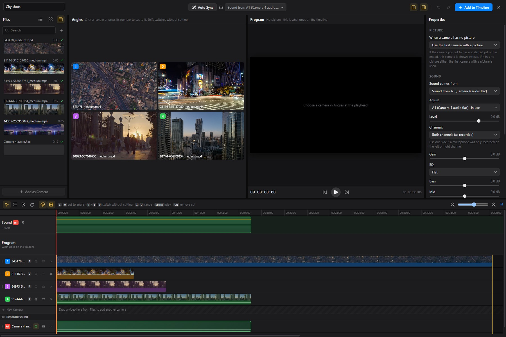

### Make room for the pictures

The two buttons at the top right of the window hide and show **Files** and **Properties**, the same buttons as in Edit. With both hidden, Angles and Program get the whole width. Drag the dividers between the parts to change their size, and the divider above the timeline to change its height. The window remembers the layout.

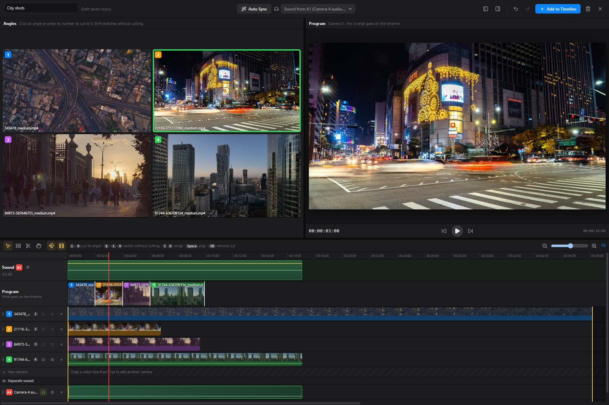

## Synchronize the cameras

Press **Auto Sync** at the top. Reccut compares the sound in every file and lines them up, so the same moment is at the same place on the timeline. Everything with sound can be synchronized, also a separate audio recorder.

If a file cannot be synchronized, a message at the top says which one and why. For example, the file has no sound, the sound is still being analyzed, or no matching sound was found because it was recorded at another time. Files that match are synchronized even when others fail. A silent audio track also has no useful sound to compare. Wait for background analysis to finish before trying again.

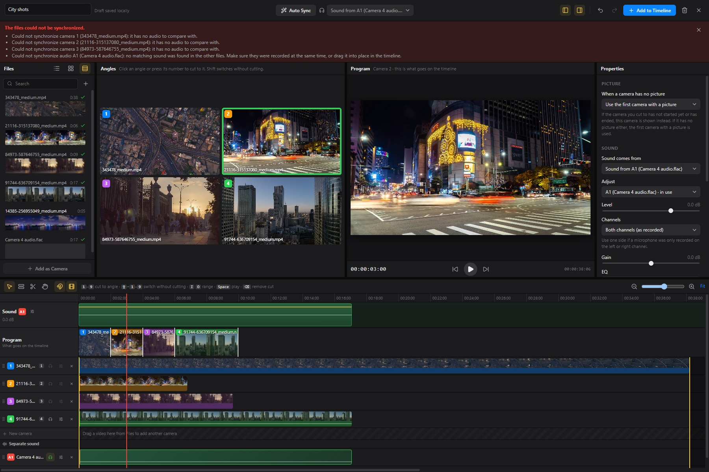

To line up one file by hand, drag its clip sideways in its track. Snapping (N) helps you hit the start or end of the other clips. To synchronize only one file, for example one you just added, right click its clip and choose **Synchronize to Audio**. The other files stay where they are.

After synchronization, check a shared event such as a clap, a word or an object touching a surface. Review the beginning and end of a long recording. Synchronization adjusts where files start, so visible timing differences later in a recording still need to be reviewed.

## Switch cameras

New multicam clips start with an empty Program. Choose a camera to begin, then switch cameras manually or during playback. Only the sections you have reviewed and chosen are added to the result; unreviewed gaps and the remaining tail stay empty. Opening an existing multicam clip keeps its previous choices and lets you continue beyond its old endpoint.

- Press **1** to **9** to cut to that camera at the playhead. This works while the video plays, so you can switch cameras live, like a director.
- When paused, the choice applies from the playhead to the next existing cut or the end of the chosen section. A first choice in an empty section starts with one frame. You can try different cameras at the same position without changing the choices before or after that section.
- Click a camera in Angles to do the same.
- Hold **Shift** with the number, or Shift click, to change the camera of the piece you are in without making a new cut.
- Each cut shows in the **Program** track with the number and color of the camera.

The number keys address the first nine video angles, including the numeric keypad. Click an angle to choose a camera beyond number 9. Separate audio sources use **A1, A2** and do not take a video shortcut.

Camera choices always use the **playhead**. Skimming previews the frame under the pointer. Move the playhead to that position before choosing a camera there.

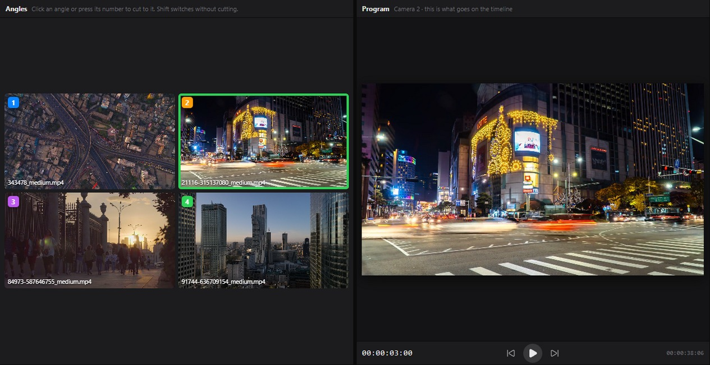

### Choose sections while paused

1. Put the playhead at the first frame you want and press **1**, or click camera 1. The first choice in an empty part of Program covers one frame.
2. Move forward to the next change and choose camera 2. Camera 1 fills the interval between the previous choice and this change.
3. Keep moving forward and choosing cameras. At the last frame you want to include, choose the current camera again to extend the reviewed section through that frame.
4. To correct an existing section, move the playhead inside it and choose another camera. That changes the picture from the playhead to its next cut or existing end. Earlier and later sections keep their choices.
5. To replace the whole current section, hold **Shift** while choosing the camera. The existing section boundaries are kept.

Moving the playhead through an empty part alone does not add video. A later choice can leave an unreviewed gap between separate sections. Review the Program track before applying the edit.

### Switch during playback

Choose the first camera and press **Space**. The chosen camera extends as playback passes through new footage. Press another number at each change. Pause to inspect or correct a section, then resume to continue. Playback can also extend a choice while reviewing backward with **J**. Existing later cuts still bound the sections being extended.

Older saved multicam clips can already have camera choices across their full length. Opening one keeps those saved choices. New multicam clips use the empty-Program workflow described here.

### When a camera has no picture

Cameras often start and stop at different times. If the camera you cut to has no picture at that moment, Reccut shows another camera instead, so the video never goes black. Those pieces are striped in the Program track. Under **Properties**, choose which camera to use instead in **When a camera has no picture**:

- **Use the first camera with a picture** (the default).
- **Use camera 2**, or any other camera, as the fallback. If that camera has no picture either, the first camera with a picture is used.
- **Leave a gap**, for an empty space instead.

You can also right click a camera's clip and choose **Use as Fallback Camera**.

### Change the angle by hand

Right click anywhere in the multicam timeline and choose **Active Video Angle** to show another camera in the piece you clicked, without making a new cut. **Active Audio Angle** chooses where the sound comes from: one of the cameras, a separate audio file or **Follow the Picture**. The current choice has a check mark.

The same menus are on the multicam clip in the Edit timeline. Right click a clip from the multicam clip and choose **Active Video Angle** or **Active Audio Angle**. The clip changes camera, or the sound changes, without opening the multicam window. The clip keeps its trim, effects, keyframes and transitions; only the camera changes. If the camera has no picture for the whole clip, Reccut says so and leaves the clip as it is.

## The multicam timeline

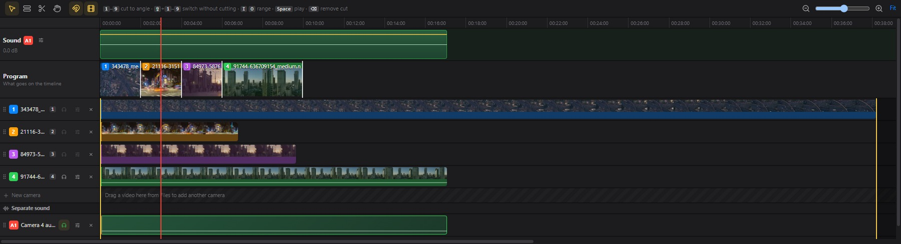

From the top:

- **Sound**: the sound that is used, with its level.
- **Program**: the cuts, which go on the timeline.
- **One track per camera**, named **1, 2, 3** with the keyboard shortcut next to the name. The headphones use the sound from that file, and the sliders button opens its settings.
- **New camera**: an empty track. Drag a video here from Files to add another camera.
- **Separate sound**: audio recorded separately, named **A1, A2**.

Sound, Program and the ruler stay at the top when you scroll down through many cameras.

### Track height

Program is a little taller than the other tracks. To make any track taller or lower, drag the bottom edge of its header on the left. Hold **Shift** while you drag a camera or sound track to change all of them at once. Double click the edge to go back to the standard height.

The timeline works like the one in Edit:

- Zoom with **Cmd +** and **Cmd -** (Ctrl on Windows), pinch, or the slider. **Shift Z** or **Fit** shows everything.
- Scroll sideways with the trackpad, Shift and the mouse wheel, or the Hand tool (H).
- **Skimming** (S) shows the frame under the pointer in Angles and Program. **Snapping** (N) makes cuts and clips snap to each other and to the playhead.
- **Select** (A) and **Trim** (T): drag a cut sideways to fine tune it. **Blade** (B): click the Program track to add a cut.
- **Backspace** or **Delete** removes the selected cut, or the one under the playhead. If the previous section touches it, the previous camera continues through that section. Removing the first or an isolated choice can leave Program empty there.
- **Up** and **Down Arrow** jump between cuts. **Left** and **Right Arrow** step one frame.
- **I** and **O** set which part goes on the timeline. The rest is darker. **Alt X** clears it.
- **Space** plays and pauses, and **J**, **K** and **L** play backward, pause and forward.
- The window has its own **Undo** (**Cmd/Ctrl Z**) and **Redo** (**Cmd/Ctrl Shift Z**).

Dragging a cut changes the boundary between adjacent choices. It stops at the neighboring cuts and at the existing end of the reviewed section. Zoom in for frame-level adjustments. Removing a cut or a camera in this window changes the multicam definition. Source files remain available in the project browser.

### Choose an output range

Put the playhead at the desired start and press **I**, then move to the desired end and press **O**. The region outside the range is shaded. **Alt X** on Windows or **Option X** on Mac clears the range.

I/O marks limit which part of the chosen Program is sent to the timeline. They do not choose cameras in empty areas. Without explicit I/O marks, the output starts at the first chosen section and ends at the last chosen section. Empty space before and after those sections is excluded. Gaps between chosen sections keep their timing in the output. A fixed audio source can continue through these internal video gaps.

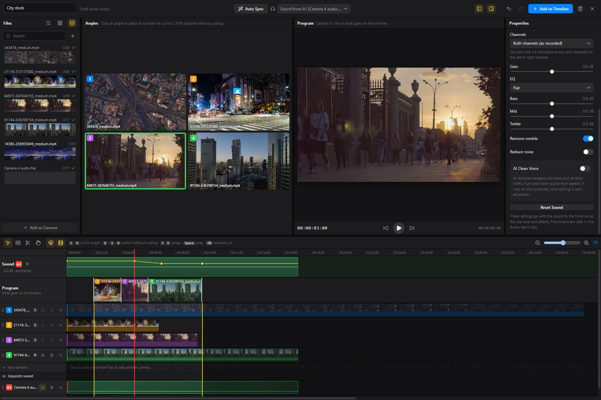

### Change the order of the tracks

Drag a track by its header on the left, up or down. The numbers and the keyboard shortcuts follow the new order, so the camera you drag to the top becomes camera 1. Separate sound tracks can be reordered among themselves in the same way.

### Add a camera afterwards

You can add cameras at any time, also to a multicam clip that is already on the timeline. Open it with **Edit Multicam Clip**, then drag a video from Files to the **New camera** track, or to the place in time where it belongs. Then right click it and choose **Synchronize to Audio**.

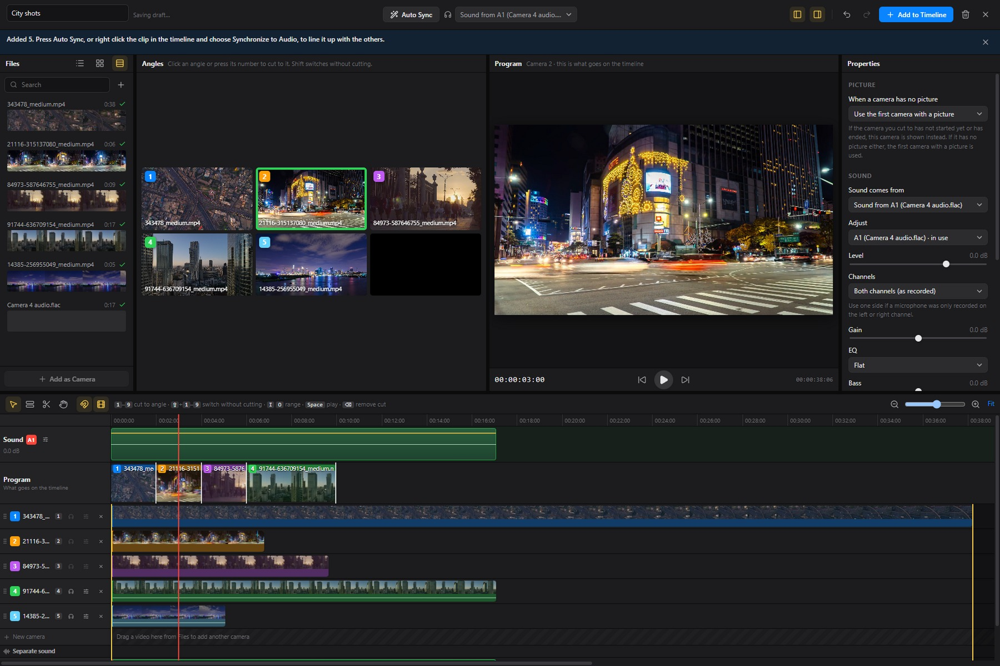

You can also double click a file in Files to add it. Right click a camera track and choose **Remove from Multicam Clip**, or use the X in its header, to remove an angle. Review Program afterwards because choices that used the removed angle need another available camera. Undo restores the previous setup.

### Remove source media from the project

In the main media browser, select a file and press **Backspace** or **Delete** to open its removal dialog. The dialog lists affected multicam clips and any timeline use. Removing a source also removes multicam clips that depend on it, across the project's sequences.

**Remove from Project** keeps the files on disk and supports Undo. The red **Delete from Disk** button also moves the source files to the Windows Recycle Bin or Mac Trash. Undo restores project entries, so restore trashed files too before continuing to use them. **Don’t show this again** applies to project-removal warnings. Disk deletion still uses the dialog.

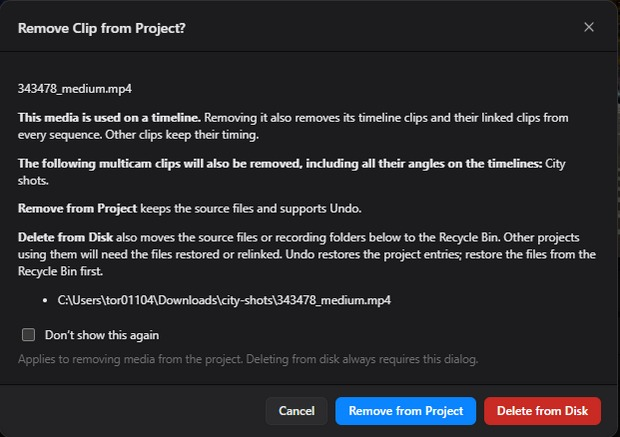

## Sound

### Sound recorded separately

Sound from an external recorder or a lavalier microphone is usually better than the sound in the cameras. Add the audio file like a camera: double click it in Files, or drag it to the **Separate sound** part of the timeline. It is named **A1** and is used for the sound straight away. Press **Auto Sync**, or right click it and choose **Synchronize to Audio**, to line it up.

### Choose where the sound comes from

Choose the sound at the top of the window, in **Properties**, with the headphones in a track, or by right clicking a clip and choosing **Use Sound from This File**:

- One of the cameras.
- One of the separate audio files.
- **Sound follows the picture**: the sound switches together with the camera.

### The Sound track

The sound that is used lies at the top of the timeline, so it is easy to see and adjust:

- Drag the **yellow line** up or down to change the level. The level shows on the left.
- **Alt (Option) click** the line to add a keyframe. Drag a keyframe up or down to change the level there, or sideways to move it.
- Drag the line between two keyframes to move both.
- Right click a keyframe to delete it, or right click the track to remove all keyframes.

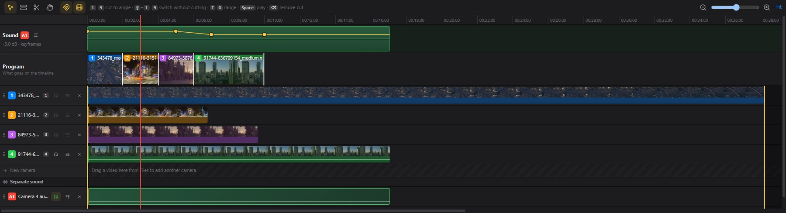

### Adjust the sound

Under **Properties**, choose the file in **Adjust** and set:

- **Level**: the volume. With keyframes, Level moves the whole line up or down.
- **Channels**: **Both channels**, **Left channel only**, **Right channel only**, **Swap left and right** or **Mix to mono**. Use one side when a microphone was only recorded on the left or right channel, which is common with external recorders and cameras with two microphone inputs.
- **Gain**: turns the sound up or down before the other settings.
- **EQ**: a starting point such as **Voice Boost** or **Podcast**, and **Bass**, **Mid** and **Treble** to adjust it.
- **Remove rumble**: removes low noise from wind, traffic and handling.
- **Reduce noise**: removes steady hiss and fan noise.
- **AI Clean Voice**: removes background noise such as fans, traffic, hum and room sound from speech, with a **Strength** slider. The first time, Reccut cleans the sound in the background; you hear the original until it is done. It is the same AI Clean Voice as in the Audio tab in Edit, it runs on this computer and nothing is sent anywhere.
- **Reset Sound** sets everything back.

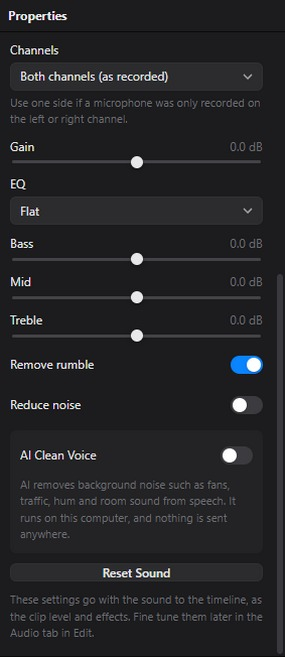

Nothing is changed automatically. You hear the settings while you play in the multicam window, and they follow the sound to the timeline as the clip level, keyframes, AI Clean Voice and ordinary audio effects. You can fine tune them later in the Audio tab in Edit.

## Add it to the timeline

Press the blue **Add to Timeline** button at the top right, or **Cmd Return** (Ctrl Enter on Windows). The result is a group of clips with an **MC** badge: one video clip for each cut, and the sound below.

- Made from clips on the timeline, the multicam clip replaces them in the same place.
- Made from files, it is added at the end of the storyline.

The first selected source frame becomes the start of the new timeline result. The output ends at the last selected frame within the I/O range, even when the available camera files are much longer. Sound is cropped to that output span. With **Sound follows the picture**, the selected camera supplies the sound for its section.

Program needs at least one camera choice before it can be added. If the window says to choose a camera, return to the intended start frame and select an angle.

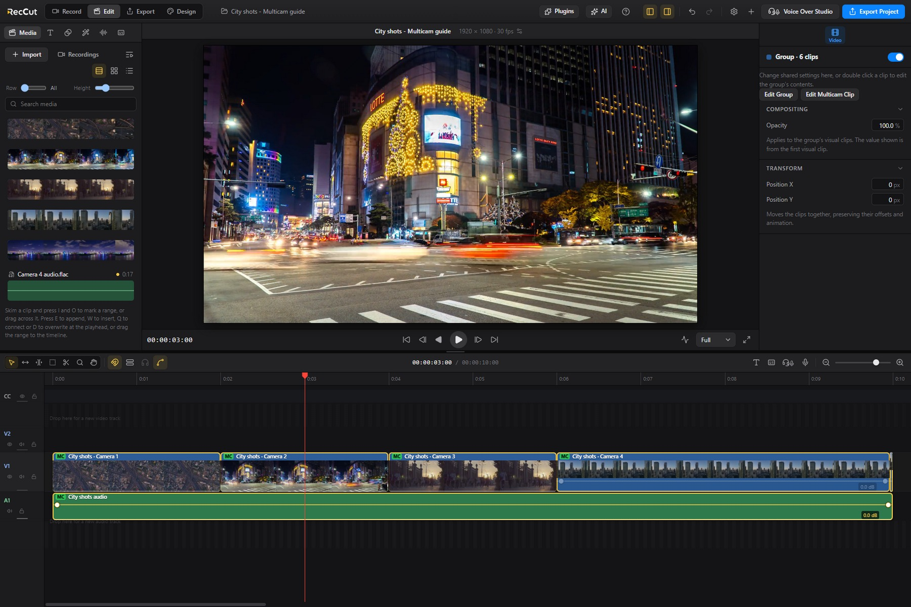

## Change it later

- **Double click** the multicam clip to edit the clips inside like any other clips, for example to add effects, color or titles. Press Esc when you are done.
- **Cmd double click** (Ctrl double click on Windows), right click and choose **Edit Multicam Clip**, or press **Edit Multicam Clip** in the inspector, to open the multicam window again. Switch cameras, add cameras or change the sound, then press **Update Timeline**.

Work you did on the timeline is kept. When the window opens, it reads the clips as they are: cuts you moved or trimmed, clips you split with the blade, a trimmed start or end, and the level and keyframes of the sound. When you update, every piece gets back its effects, keyframes, color, transitions and on or off state, and a trimmed audio clip keeps its length.

To continue after the old end, move the playhead to the next position you want, choose a camera and keep reviewing. New picture and automatically generated sound can extend past the old output endpoint. An I/O range you set yourself still limits the output until you change or clear it. Audio trims made deliberately on the Edit timeline are kept.

There is one exception. If you deleted a piece in the middle of the multicam clip, or changed the speed of one of its clips, that cannot be described as cuts. The window then tells you, and asks before **Update Timeline** puts the removed part back. Switching a camera with **Active Video Angle** on the timeline always keeps everything.

## Save and recover an unfinished edit

Changes are saved automatically as a local draft while you work. The header changes from **Saving draft…** to **Draft saved locally**. Saving a draft also happens when you close with **Esc** or the X. The Edit timeline receives the result when you use **Add to Timeline** or **Update Timeline**.

1. Open the same project and sequence.
2. Choose **File › Resume Multicam Draft…**, or use the recovery notification. If several drafts are available, select the one you want.
3. Continue from the restored camera choices and playhead position.
4. Apply the result to the timeline when it is ready. This clears the completed draft.

Drafts belong to each project and sequence and stay in this computer's Reccut profile. They are not included in the project file or transferred with it. For a project you plan to move or share, apply the multicam result and save the project first. An unexpected shutdown can lose changes since the most recent draft save.

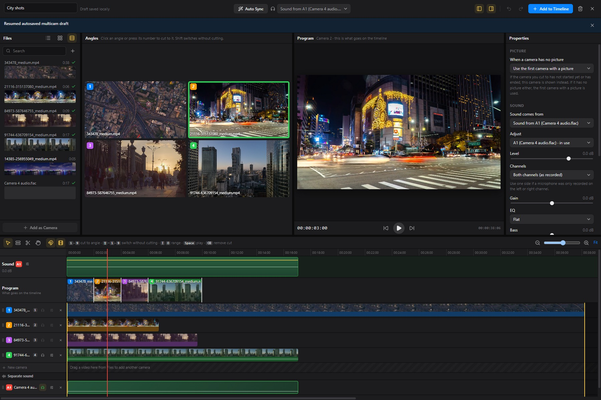

Use the trash button beside **Add to Timeline** or **Update Timeline** to discard the current draft. Reccut asks before removing those unfinished changes.

If the timeline changed after a draft was started, Reccut warns before applying it replaces the current multicam clips.

If the header says **Draft could not be saved**, keep the window open and check available storage. Applying a finished result to the timeline and saving the project also preserves that edit.

## Keyboard reference

These keys apply while the multicam window is active and you are not typing in a field. On Mac, use **Cmd** for the Ctrl combinations below and **Option** for Alt.

- **1–9** or the numeric keypad choose a camera at the playhead. **Shift 1–9** switches the current section without adding a cut.
- **Space** plays or pauses. **J** plays backward, **K** pauses and **L** plays forward. Repeated J or L increases the speed up to 8×.
- **Left/Right Arrow** steps one frame. **Shift Left/Right Arrow** moves one second. **Up/Down Arrow** jumps between cuts. **Home/End** goes to the current range boundaries.
- **I/O** marks the output range. **Alt X** clears it.
- **A** selects, **T** trims, **B** selects the Blade tool and **H** selects the Hand tool.
- **S** toggles skimming. **N** toggles snapping.
- **Ctrl +/−** zooms. **Shift Z** fits the whole source duration.
- **Backspace/Delete** removes a selected cut or the cut under the playhead.
- **Ctrl Z** undoes within multicam. **Ctrl Shift Z** or **Ctrl Y** redoes.
- **Ctrl Enter** adds or updates the timeline. **Esc** closes and saves the draft.

## Troubleshooting

### Program is black or Add to Timeline asks for a camera

A new Program is empty until you choose an angle. A gap after the last reviewed section is also empty. Place the playhead on a chosen section to review it, or choose a camera where the new section should start. If the selected source itself has ended, check the fallback setting in Properties.

### The camera choice happens somewhere other than the preview

With skimming on, the pointer can preview another time while the playhead stays in place. Camera shortcuts use the playhead. Click the ruler to move it, or toggle skimming off with S, then choose the camera.

### Auto Sync cannot find a match

Read the reason for each file at the top. Finish media analysis first. Confirm that both files contain audible recordings of the same event. Silent tracks, unrelated clips and files without sound need manual alignment. After adding a new angle, **Synchronize to Audio** adjusts that file alone.

### There is no sound, or it comes from the wrong camera

Choose **Sound comes from** at the top or in Properties. Check that the source actually contains audible audio and overlaps the output interval. In **Sound follows the picture**, choosing a silent camera also chooses its silence. Use one continuous microphone source when the sound should stay consistent. Check Level, Gain and Channels, and try Reset Sound if needed.

### A different camera appears after a source ends

Check **When a camera has no picture** in Properties. The default uses another camera with available picture and marks that Program section with stripes. Choose a specific fallback camera, choose a camera that covers the interval, or use Leave a gap.

### New choices are missing after Update Timeline

Check the I/O marks. Clear a deliberate range with **Alt X** or **Option X**, or set a later Out point. Confirm that the new section appears in Program and that you used Update Timeline after making the choices.

### A draft seems to be missing

Return to the project and sequence where it was started, using the same Reccut profile on the same computer. Open **File › Resume Multicam Draft…**. Applying or explicitly discarding a draft removes it from this list. Once applied, reopen it through Edit Multicam Clip on the timeline.

## Tips

- Start every camera before the action begins and clap once in front of all of them. A clear sound makes Auto Sync more reliable.
- Keep the camera sound on even when you use an external recorder. Auto Sync needs it to find the right place.
- Reccut recordings already switch between screen and camera, so they cannot be used as cameras in a multicam clip.
