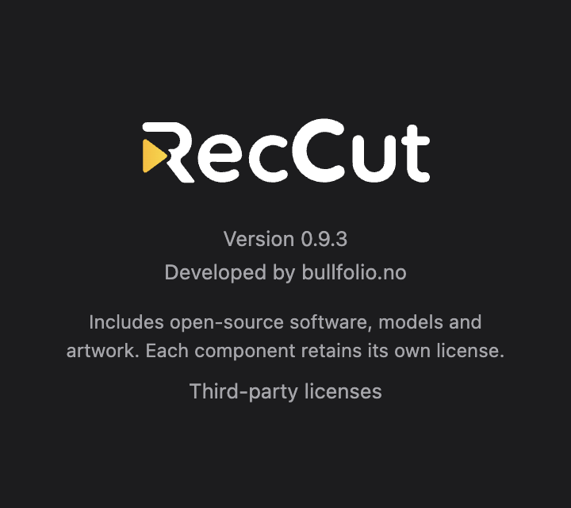

# Reccut 0.9.3

Prepared on 12 November 2026. Version metadata is set to **0.9.3**; the matching
release tag is **v0.9.3**. This document prepares the release and does not mean
that a tag, GitHub release or installers have been published.

## Changes since 0.9.2

- **Voice Over Studio:** record narration or talking-head takes from a script,
  compare takes, adjust timing on the studio timeline and stitch the selected
  takes into your edit. People have separate tracks and sound settings, with
  room tone and configurable pauses.
- **Local AI voices:** choose Kokoro, language-specific Piper packages or
  expressive VoxCPM2 voices. VoxCPM adds two synthetic voices for each of
  Norwegian, US English, Swedish, Danish and German on Apple Silicon Macs.
  Choose Neutral, Intense, Angry, Sad, Warm, Sensual, Cheerful, Confident,
  Reassuring or Whispering. All 100 VoxCPM previews can be played before download.
- **Voice packages and optional models:** one searchable voice package chooser
  in the studio and Settings, with sizes, licenses, samples and explicit download
  selection. VoxCPM languages share one model of about 3.55 GB. AI models are
  downloaded when requested, rather than bundled with the installer.
- **Audio:** quick microphone recording, voice cleanup, Voice Character and
  narration templates, plus improved audio scrubbing and playback transitions.
- **Editing and captions:** roll editing across neighboring grouped clips,
  improved trim pointers, Highlight Area with adjustable drop shadow, and script
  captions split to a maximum of 42 characters per line.
- **Recording shortcuts:** background recording shortcuts are enabled by default
  and can be changed under **Record → Shortcuts**.

See [AI voice instructions](../AI-VOICES.md), the [full feature list](../FEATURES.md)
and the app's Voice Over Studio help for usage details.

## Limits in this first voice release

VoxCPM2 is enabled only on **Apple Silicon Macs**. Windows, Linux and Intel Mac
support require separate performance measurements and platform testing. Kokoro,
Piper and microphone recording remain available as alternatives.

Voice quality and expression strength vary. The Norwegian male voice can repeat
or mispronounce “oss”; this is a known limitation, not a fixed issue. The current
voices were accepted for a first version, with further quality adjustments
deferred. Mood changes affect new takes; they do not rewrite existing audio.

## Version and artifact contract

`package.json` and `package-lock.json` must both say 0.9.3. About, update checks,
Keystroke Add-on downloads and the VoxCPM engine use `app.getVersion()`. Do not
hardcode the version in their implementation. Engine downloads for this release
must come from `https://github.com/sirbull/reccut/releases/download/v0.9.3/`.

The tagged workflow in [build.yml](../../.github/workflows/build.yml) prepares:

| Component | Required release attachments |
| --- | --- |
| Reccut installers | macOS ARM64/Intel `.dmg`, Windows x64 installer and Linux x64 AppImage from the platform build jobs |
| Keystroke Add-on | `reccut-keystrokes-mac`, `reccut-keystrokes-win-x64.exe`, `reccut-keystrokes-linux-x64`, each with its `.sha256` |
| VoxCPM engine | `reccut-voxcpm-mac`, its `.sha256` and `.LICENSE.txt` |
| VoxCPM references | Ten `reccut-voxcpm-<voice-id>.wav` files, each with its `.sha256`, plus `reccut-voxcpm-voices.json` and `reccut-voxcpm-voices.LICENSE.txt` |

Model files and reference WAVs are excluded from installers. The 100 OGG listening
samples are included. Reference hashes and model hashes are pinned in
`src/main/ttsCatalog.json`; engine hashes are produced by the build. No script or
recording is sent over the network for synthesis. Full component notices are
generated offline and included with the app.

When updating from 0.9.2, unchanged VoxCPM models and references are retained;
the matching 0.9.3 engine is installed when requested. A developer can use
`scripts/install-voxcpm-local.mjs` with existing local files instead of downloading.

## Verification and publication

Local verification on 12 November 2026:

| Check | Result |
| --- | --- |
| Package and lockfile | Both root versions and the lockfile's package entry are 0.9.3; set with `npm version 0.9.3 --no-git-tag-version` |
| Build and tests | Build passed; all 871 tests passed |
| Actual About window | Started with `npm start`, selected Reccut → About Reccut, and verified **Version 0.9.3** from `app.getVersion()` |
| Version routing | Update check and intercepted Keystroke/VoxCPM requests use 0.9.3; no public release downloads were attempted |
| Electron UI checks | Voice Packages and VoxCPM picker checks passed in disposable profiles |
| Real installed voices | English Warm and Norwegian Sensual passed at 48 kHz, with sentence progress and one reused model process; [report](../voxcpm-0.9.3-check.json) |
| Local release files | Engine and ten reference files staged with licenses and manifest; all 11 binary/reference SHA-256 pairs verified |

The [validation record](0.9.3-validation.json) distinguishes local checks from
the pending public-release and packaged-platform checks.

The earlier voice-quality review and first-version acceptance remain in
[the expression report](../voxcpm-expressions-review.json); automated tests do
not establish error-free pronunciation.

Before marking the GitHub release ready:

1. Confirm package and lockfile versions, run `npm test`, and build the app.
2. Run `npm start`, open **Reccut → About Reccut** and verify **Version 0.9.3**.
3. Run the voice-package and voice-picker UI checks. Verify real local synthesis
   using `scripts/test-voxcpm-installed.mjs` when the optional model is installed.
4. Check that the `v0.9.3` tag points at the intended release commit. Run the
   GitHub workflow and inspect every platform job and its attachments.
5. Verify the Keystroke binary/checksum pairs and all VoxCPM engine/reference
   attachments listed above. Download them from the actual release, check hashes,
   and test an explicit voice installation on an Apple Silicon Mac.
6. Smoke-test the packaged apps on their target platforms, including About,
   update checks and optional add-on installation. These checks cannot be
   replaced by local source-build tests on a Mac.

GitHub builds, publication, actual release downloads and packaged-platform checks
remain pending until performed. Windows/Linux VoxCPM work is a separate later phase.
