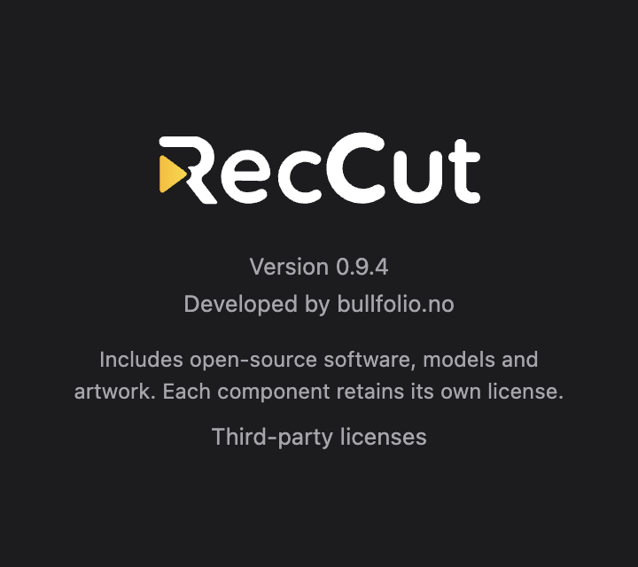

# Reccut 0.9.4

Reccut 0.9.4 adds multicam editing, animated captions and new audio controls.

- **Multicam:** synchronize camera angles with shared sound, choose shots with the number keys, keep continuous audio, trim a selected range and recover unfinished work from local drafts. Timeline edits and effects are preserved when reopening multicam clips.
- **Captions:** animated word styles and improved word timing.
- **Audio:** music ducking, loudness normalization and improved microphone selection and room tone recording in Voice Over Studio.
- **Media browser:** list view, source preview improvements and media removal controls.
- **Help:** an illustrated multicam guide, improved handbook navigation and a searchable website handbook. About, Help, the startup screen and update checks use version 0.9.4.
- **AI models:** clearer model choices and license information. Whisper, BiRefNet and AI voice packages are downloaded only when requested.

## Downloads

macOS Apple Silicon (ARM64) is published first as `Reccut-0.9.4-arm64.dmg`. Windows x64 follows as `Reccut.Setup.0.9.4.exe`. The build workflow also produces a Linux x64 AppImage.

## Optional add-ons

The `reccut-keystrokes-*` and `reccut-voxcpm-*` files are optional downloads, separate from the installers. Binary and voice reference files include matching SHA-256 checksums. No global keyboard reader is bundled with Reccut.

## Known limitations

VoxCPM2 is available only on Apple Silicon Macs. Kokoro, Piper and microphone recording are available as alternatives on other platforms. AI pronunciation and expression quality vary; the Norwegian male VoxCPM voice can repeat or mispronounce words.

The macOS app uses ad-hoc signing and is not notarized. See the [installation guide](../../README.md#install), [multicam guide](../MULTICAM.md) and [AI voice guide](../AI-VOICES.md).

[Changes since 0.9.3](https://github.com/sirbull/reccut/compare/v0.9.3...v0.9.4).

